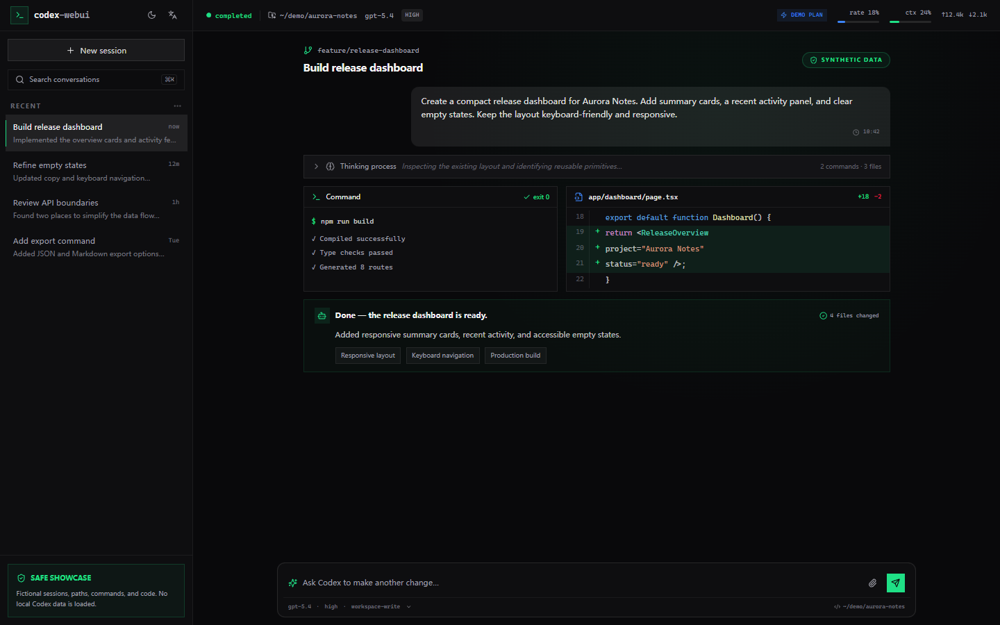

# Codex Web UI

<p align="center">
  
</p>

一个面向 [OpenAI Codex CLI](https://github.com/openai/codex) 的轻量化本地图形界面。它以 Codex CLI 为底层引擎，将对话、历史会话、配置和文件差异集中呈现在浏览器中。全部服务仅运行在 `127.0.0.1`，供本地单用户使用。

[English](./README.md) · [开发说明](./DEVELOPMENT.md)

上游项目：[openai/codex](https://github.com/openai/codex)

---

## 界面预览



该图片截取自 `/showcase`：正式版 `AppShell` 与真实 UI 组件运行在隔离的虚构数据层之上。Fixture 包含 3 个临时项目和 3 个非项目会话；它不会读取本地会话、调用 Codex CLI、访问真实文件系统，也不会向后端 API 发送请求。

## 为什么需要

Codex CLI 功能强大，但完全在终端中跟进长任务或回顾历史会话并不总是方便。本项目在 Codex CLI 之上提供一个轻量化的浏览器图形界面，让你可以：

- 以富文本渲染（Markdown、代码高亮、LaTeX、统一 diff）观看流式对话
- 浏览并回放任意历史会话 —— 包括 7 天以上的 `.jsonl.zst` 归档
- 用新提示词续接已结束的会话
- 可视化调整模型 / 推理强度 / 沙箱 / 审批策略，按会话独立保存
- 借助虚拟滚动与逐消息导航，快速浏览长会话

完全本地运行，无需部署服务器、无需鉴权、无远程访问 —— 开发与生产服务器均只绑定 `127.0.0.1`。

## 功能特性

| 模块 | 说明 |
|---|---|
| **流式对话** | 通过 stdio JSON-RPC 连接 `codex app-server`，将通知映射为 SSE，实时渲染智能体消息、推理、命令、文件变更、MCP、搜索、计划与轮次边界。 |
| **会话回放** | 扫描 `~/.codex/sessions/` 与 `~/.codex/archived_sessions/`（含 `.jsonl.zst` 归档），以与实时流相同的渲染管线回放任意历史会话。 |
| **续接会话** | 选择一条历史会话，输入新提示词 —— app-server 将下一轮追加到同一时间线。 |
| **隔离展示工具** | 在 `/showcase` 中使用虚构项目和会话运行正式界面，可安全用于截图、演示、视觉测试和上手介绍。 |
| **差异查看器** | `file_change` 项打开全屏统一 diff 对话框，含增/删/上下文行着色、双行号、语法高亮、一键复制 patch。 |
| **配置面板** | 模型、推理强度、协作模式（`Default` / `Plan`）、沙箱、审批策略与工作目录 —— 按会话持久化到 `localStorage`。 |
| **结构化提问** | Plan 模式下将 `request_user_input` 渲染成选项/文本卡片；提交后通过 `/api/exec/respond` 在同一轮继续执行。 |
| **用户附件** | 图片输入以紧凑缩略图显示在发言框上方并支持全屏预览；其他文件显示文件名/路径卡片。Codex 注入的文件与浏览器元数据不会进入可见正文。 |
| **斜杠命令** | 注册 15 条 codex CLI 命令（`/approvals`、`/architect`、`/clear`、`/compact`、`/diff`、`/goal`、`/help`、`/init`、`/mode`、`/model`、`/plan`、`/review`、`/sandbox`、`/skills`、`/status`），输入 `/` 触发自动补全菜单。 |
| **Skills `@` 补全** | 扫描 `~/.codex/skills/` 与已启用插件，通过 `@` 插入 skill 引用。 |
| **对话导航** | 左侧竖排圆点导航对应每条用户消息；悬停浮出预览，点击跳转，滚动时自动高亮当前圆点。 |
| **可折叠思考过程** | 连续的中间过程事件（推理 / 命令 / 文件 / 搜索 / mcp / 计划）合并为单个可折叠块，显示摘要预览与动作计数。 |
| **代码高亮** | Token 配色对齐 VSCode Dark+ / Light+ 主题，关键词、函数名、字符串、数字、内置类型、参数均已校验一致。 |
| **回复图片** | Markdown 图片采用限制尺寸且适配主题的渲染方式；`~/.codex/visualizations/` 下的本地图片通过受控只读接口加载，缺失或被禁止的图片显示紧凑失败卡片，不再出现破损细线。 |
| **虚拟滚动** | `@tanstack/react-virtual` 动态测量，保证长会话（数百事件）流畅滚动。 |
| **中止** | 停止按钮（或关闭标签页）中止 fetch、杀死 codex 子进程，保留部分 rollout 以便续接。 |
| **明暗主题** | 默认跟随系统，并支持手动选择亮色、暗色或跟随系统；选择结果跨会话持久化。 |
| **界面语言** | 默认跟随系统，并支持手动选择简体中文或英语；紧凑菜单即时生效、持久化，并同步更新页面语言属性。 |

## 前置要求

- **Node.js 18.18+**（Next.js 15 要求）
- **Codex CLI** 已安装并完成认证：

  ```bash
  npm install -g @openai/codex
  codex login          # ChatGPT 登录（推荐）
  # — 或 —
  $env:CODEX_API_KEY = "sk-..."   # API key（仅 exec 模式）
  ```

  验证：`codex --version` 能输出版本号。

## 快速开始

```bash
git clone https://github.com/<your-org>/codex-webui.git
cd codex-webui
npm install
npm run dev
# 打开 http://127.0.0.1:3000
```

生产模式：

```bash
npm run build
npm start              # 服务于 127.0.0.1:3000
```

`dev` 与 `start` 均只绑定 `127.0.0.1`，无远程访问。

## 隔离 Showcase 工具

`/showcase` 是一个独立的界面展示与测试工具，不会暴露你的真实项目或会话。正常启动应用后，打开 [http://127.0.0.1:3000/showcase](http://127.0.0.1:3000/showcase) 即可使用。

它挂载与主应用相同的正式版 `AppShell` 和 UI 组件，并提供 3 个虚构项目与 3 个虚构的非项目会话，可用于 README 截图、产品演示、视觉测试和上手介绍。

Showcase 使用独立缓存与偏好设置，应用发出的所有 API 请求都由内存中的模拟数据响应；未知 API 路由与外部请求会被拒绝。它不会读取 `CODEX_HOME`、本地会话或真实文件系统，也不会调用 Codex CLI；在输入框中提交内容时只会得到模拟响应。

## 工作原理

```
浏览器 ──POST /api/exec──▶ Next.js Route Handler
                              │
                              ├─ 解析 codex 二进制 (binary.ts)
                              ├─ 构造 argv (args.ts)
                              ├─ 启动 codex exec --json (spawn.ts)
                              └─ stdout JSONL ──▶ SSE 帧 ──▶ 浏览器
                                                    │
                                                    └─ useReducer 时间线

浏览器 ──GET /api/sessions/:id/events──▶ replay.ts
                                              │
                                              ├─ 读取 rollout .jsonl[.zst]
                                              ├─ 映射 items → item.completed 事件
                                              └─ SSE ──▶ 与实时流相同的 reducer
```

后端本身不存储会话 —— 直接读取 codex 自己的 rollout 文件，保证唯一数据源。实时流与回放共用同一个 reducer，渲染效果完全一致。

### 二进制解析

应用按以下顺序解析 codex 二进制：

1. `CODEX_BIN` 环境变量（可执行文件绝对路径）
2. `CODEX_JS` 环境变量（`@openai/codex/bin/codex.js` 绝对路径）
3. npm 全局的 `@openai/codex/bin/codex.js`，通过 `node` 启动（平台无关，规避 Windows `.cmd` 垫片 / `shell:true` 注入风险）
4. 从 `PATH` 解析 `codex`（兜底）

Windows 上优先使用 Node 启动器而非 `.cmd` 垫片，出于安全考虑。

## 配置

### 环境变量（`.env.local`）

| 变量 | 默认值 | 用途 |
|---|---|---|
| `CODEX_BIN` | — | codex 可执行文件绝对路径。Windows 上建议用真实二进制（而非 `.cmd` 垫片）。 |
| `CODEX_JS` | — | `@openai/codex/bin/codex.js`（Node 启动器）绝对路径。原生二进制解析失败时使用。 |
| `CODEX_HOME` | `~/.codex` | 覆盖 codex 主目录（`sessions/`、`archived_sessions/`、`auth.json`、`skills/` 所在位置）。 |

### 应用内偏好

模型、推理强度、协作模式、沙箱、审批策略、工作目录按会话保存到 `localStorage`（键名 `codex-webui-prefs-v3`）。界面语言独立保存到 `codex-webui-language`，值为 `system`、`zh-CN` 或 `en`。

## 已知限制

- **结构化提问需要 Plan 模式。** Codex 仅在 Plan 模式开放 `request_user_input`；Default 模式直接执行任务。权限审批由 Codex 自动审查器处理，不显示为用户问题卡片。
- **Windows `.cmd` 垫片。** 若 codex 经 npm 安装于 Windows，应用优先通过 `node` 启动 `codex.js` 以规避 `.cmd` 垫片 / `shell:true` 安全问题。若失败，请将 `CODEX_BIN` 指向真实可执行文件。
- **单用户。** 无鉴权、无多租户隔离。仅绑定 `127.0.0.1`。
- **Rollout 只读。** UI 从不写入 `~/.codex/sessions/`；codex 是唯一写入方。7 天以上的 `.jsonl.zst` 归档由 fzstd 实时解压。

## 故障排除

**`codex executable not found`** —— 将 `CODEX_BIN` 设为 codex 二进制绝对路径，或确保 `codex` 在 `PATH` 中且 `codex --version` 在启动开发服务器的同一 shell 中可用。

**`Model metadata for 'gpt-5-codex' not found`** —— 这是 codex CLI 的警告（在时间线中显示为错误卡片），并非 Web UI 问题。请在终端直接运行 `codex` 确认；如需切换模型，使用配置面板。

**控制台 Hydration 警告** —— 浏览器自动化工具注入的 `data-trae-ref` 属性可能导致 SSR/客户端属性不匹配警告。这些仅是开发期产物，不影响生产。

**3000 端口被占用** —— 其他进程（通常是残留的开发服务器）占用了端口。结束它或换端口运行：`npx next dev -H 127.0.0.1 -p 3001`。

## 技术栈

Next.js 15 (App Router) · React 19 · TypeScript · Tailwind CSS · SWR · @tanstack/react-virtual · react-markdown · rehype-highlight · KaTeX · fzstd · lucide-react · next-themes

## 开发

项目架构、目录约定与扩展指南（新增事件类型、斜杠命令等）详见 [开发说明](./DEVELOPMENT.md)。

## 开源协议

[MIT](./LICENSE)
